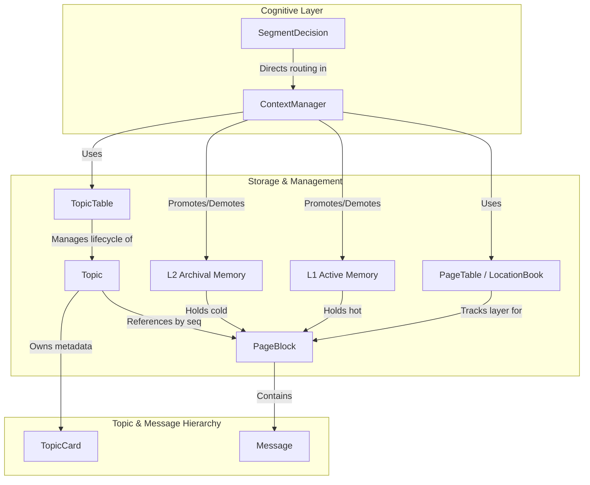

# PRISM Data Structures & Topic Table Explained

This document explains:
1. **What "Covered" (`covered_through`) means in the Topic Table**
2. **A clear, structured breakdown of every data structure in PRISM** (Fields, Purpose, How it helps the system, and Real-world analogies).

---

## 1. What Does "Covered" Mean in the Topic Table?

In the test reports and system logs, you see tables like this:

| ID | Status | Label | Key facts | Entities | Pages | Covered |
|:--:|:------:|:------|:----------|:---------|:-----:|:-------:|
| 1 | 🔴 closed | `Flight Booking` | User traveling Dec 15 | SFO, JFK | `[0, 1]` | `1` |
| 2 | 🟢 open | `Hotel Booking` | Needs 2 queen beds | Manhattan | `[2]` | `-1` |

### In Simple Words
**`Covered` (technically `covered_through` in code)** is the **highest Page sequence number (`seq`) that has already been summarized into the topic's `TopicCard`**.

* **Default Value**: `-1` (meaning *no pages have been summarized yet*).
* **When updated**: Whenever a topic is closed, PRISM's `CardWriter` summarizes the conversation and updates `covered_through = max(topic.page_seqs)`.

### Why Does PRISM Need `covered_through`?
Imagine a conversation has 10 pages for Topic 1:
1. When Topic 1 first closes after Page 0, the CardWriter reads Page 0 and writes a summary (`TopicCard`). PRISM records `covered_through = 0`.
2. Later in the conversation, the user **returns** to Topic 1. PRISM adds Page 4 and Page 5 to Topic 1.
3. When Topic 1 closes again, **how does PRISM avoid re-reading and re-summarizing Page 0?**
   - PRISM checks: `new_pages = [p for p in topic.page_seqs if p > topic.card.covered_through]`
   - Because `covered_through = 0`, PRISM **only sends Page 4 and Page 5** to the LLM CardWriter, along with the previous card!
   - It updates `covered_through = 5`.

### Benefits
- **Saves LLM Tokens & Money**: Older conversation pages are never re-read by the summarizer.
- **Incremental Memory Updates**: Facts accumulate and overwrite contradictions without processing the entire conversation history from scratch.
- **Instant Health Check**: If `Covered == max(Pages)`, the card is 100% up-to-date. If `Covered == -1`, the topic is either newly created or currently open and hasn't had its first summary written yet.

---

## 2. Core Data Structures Explained

Here is the complete breakdown of every data structure in PRISM, what fields it holds, what it does, and how it helps the system.

---

### 1. `PageTable` (LocationBook)
> **Analogy**: An OS Page Table (MMU) or a library book locator card.

#### Fields
* `_where: dict[int, str]`
  * A dictionary mapping each page sequence number (`seq`) directly to its memory layer (e.g. `{0: "L1", 1: "L2", 2: "L1"}`).

#### What it does
* **Tracks exact page locations**: Tells the system instantly whether page `seq` is residing in **L1** (active prompt memory) or **L2** (archival memory).
* **Fast lookups without scanning**: When PRISM needs to know where Page 5 is, it calls `page_table.where(5)` and gets `"L1"` or `"L2"` in $O(1)$ time instead of scanning through every storage layer.
* **Layer page listings**: `pages_in("L1")` returns a sorted list of all page IDs in L1.

#### How it helps the system
* Whenever `ContextManager.move()` transfers a page from L1 to L2 (or L2 to L1), it updates `PageTable.set(seq, dst.name)`.
* It guarantees that PRISM never loses track of a page, never keeps duplicate copies in both layers, and can move pages cleanly without searching.

---

### 2. `TopicTable`
> **Analogy**: A thread manager in an email client or forum categories with an active thread marker.

#### Fields
* `_topics: dict[int, Topic]`: Stores all topics created by their integer ID (`{1: Topic, 2: Topic}`).
* `_next_id: int`: Auto-incrementing counter for topic IDs (starts at `1`).
* `_open_id: int | None`: The ID of the currently active (open) topic, or `None` if no topic is currently active.

#### What it does
* **Tracks conversation topics**: Holds all topics that have ever occurred in the session.
* **Enforces Single-Open-Topic rule**: Only ONE topic is allowed to be open at any time. Trying to open a new topic before closing the current one raises an error.
* **Topic Lifecycle**: Provides `new_topic()`, `close()`, and `reopen()`.
* **Topic-to-Page Mapping**: `add_page(topic_id, seq)` links each page to its parent topic.

#### How it helps the system & Laya Decider
* **Helps LayaSegmenter**: Passes `open_topic` and `closed_topics()` to Laya so Laya can compare the incoming user message against the active topic and all closed topics to decide: `continue`, `new`, or `return:<topic_id>`.
* **Helps LayaRouter**: Gives the router the list of closed topics so it can calculate probabilities of which previous topics need to be retrieved into L1.
* **Identifies all pages for a topic**: Allows PRISM to easily look up `topic.page_seqs` to bring all pages of a topic from L2 into L1 when returning to that topic.

---

### 3. `PageBlock`
> **Analogy**: A physical notebook page or an OS memory page frame.

#### Fields
* `seq: int`: Permanent, globally unique sequence number (0, 1, 2, ...). Never changes even if moved between L1 and L2.
* `topic_id: int`: The ID of the topic this page belongs to.
* `data: list[Message]`: The chronological list of user/assistant messages written on this page.
* `type: str`: Structural type (default `"chat"`; extensible to `"summary"` or `"file_stub"`).
* `is_open: bool`: `True` if this page is currently active and receiving new messages; `False` if sealed.
* `tokens: int` (Property): The real-time sum of tokens of all messages contained in this page (`sum(m.tokens for m in self.data)`).

#### What it does
* **Fundamental unit of memory transfer**: PRISM does not move individual messages; it moves whole `PageBlock`s between L1 and L2.
* **Splits long topics**: When an open page reaches `max_page_tokens` (e.g. 400 tokens), PRISM marks `is_open = False` and opens a new page for the same topic.
* **Protection guarantee**: While `is_open == True`, the page cannot be evicted from L1.

#### How it helps the system
* Prevents fragmentation by bundling messages into clean chunks.
* Allows fine-grained eviction: instead of evicting an entire long conversation, PRISM can evict older pages of a topic while keeping newer pages in L1.

---

### 4. `TopicCard`
> **Analogy**: A concise library index card or executive briefing summary.

#### Fields
* `label: str`: Short title naming the topic (8 words or fewer, e.g. `"Database Migration / Postgres"`).
* `description: str`: 2–3 sentences stating only the currently valid, agreed-upon factual state.
* `key_facts: list[str]`: Concrete facts, IDs, paths, and preferences (e.g. `["port: 5432", "user: admin"]`).
* `entities: list[str]`: Proper nouns, filenames, and identifiers (e.g. `["schema.sql", "PostgreSQL"]`).
* `covered_through: int`: Highest page `seq` this card reflects (default `-1`).

#### What it does
* **Lightweight index of an entire topic**: Serves as the high-level semantic representation of a topic.
* **`as_text()` method**: Formats the card into a clean single string: `"label | description | facts | entities"`.

#### How it helps the system
* **Fast Cognitive Routing**: This is the **only** text that the Router (LayaRouter or KeywordRouter) and Segmenter inspect to evaluate previous topics.
* Instead of stuffing thousands of tokens of old chat transcripts into the prompt or running expensive embeddings on raw text, PRISM passes tiny ~100-token `TopicCard`s to Laya, allowing sub-50ms routing decisions with zero context bloat.

---

### 5. `Topic`
> **Analogy**: A file folder that holds several related pages and has a label card glued to the front.

#### Fields
* `id: int`: Unique topic identifier (1, 2, 3, ...).
* `card: TopicCard`: The descriptor card summarizing this topic.
* `page_seqs: list[int]`: Monotonically increasing list of page sequence numbers owned by this topic.
* `is_open: bool`: Whether this topic is currently being discussed.

#### What it does
* Groups related pages together under a common identity, even if those pages are separated across time.
* For example, if a user talks about Topic 1 (pages 0, 1), switches to Topic 2 (pages 2, 3), and then returns to Topic 1 (page 4), Topic 1's `page_seqs` will be `[0, 1, 4]`.

#### How it helps the system
* Keeps topic history coherent across interruptions.
* Allows the ContextManager to know all page sequence numbers to fetch when a topic is recalled.

---

### 6. `Message`
> **Analogy**: A single speech balloon or chat bubble in a messenger app.

#### Fields
* `role: str`: The speaker role (`"user"`, `"assistant"`, `"tool"`, or `"system"` for gap markers).
* `content: str`: The raw text content of the message.
* `tokens: int` (Property): Token estimation heuristic (`max(1, len(content) // 4)`).

#### What it does
* Atomic building block of the conversation.
* Measures token footprint so PRISM can accurately budget L1 capacity and detect overflow before sending prompts to the LLM.

---

### 7. `L1` (Level 1 Active Working Memory)
> **Analogy**: RAM / CPU L1 Cache — fast, limited capacity, directly fed to the processor.

#### Fields
* `max_tokens: int`: Hard limit on the number of tokens L1 can hold (e.g. 2000 tokens).
* `high_water: float`: High watermark ratio (default `0.85`, i.e. 85%). When token usage exceeds this, eviction begins.
* `low_water: float`: Low watermark ratio (default `0.70`, i.e. 70%). Target level to evict down to.
* `_pages: dict[int, PageBlock]`: Hash map of `{seq: PageBlock}` currently in L1.

#### What it does
* **Builds the LLM Prompt**: Calling `l1.render(mark_gaps=True)` flattens all pages currently in L1 in sequence order.
* **Automatic Gap Detection**: If pages were evicted (e.g. Page 0 is in L1, Pages 1-2 are in L2, Page 3 is in L1), `render()` automatically inserts:
  `Message("system", "[earlier messages omitted]")` so the LLM knows context was skipped.
* **Token Accounting**: Tracks `used_tokens`, `free_tokens`, `utilization()`, `over_high_water()`, and `above_low_water()`.
* **Guards Overflow**: Throws `L1FullError` if an insertion or message exceeds capacity.

---

### 8. `L2` (Level 2 Archival Memory)
> **Analogy**: Disk Swap / Secondary SSD Storage — virtually unlimited, holds pages not currently in prompt.

#### Fields
* `_pages: dict[int, PageBlock]`: Hash map of `{seq: PageBlock}` currently stored in L2.

#### What it does
* Holds evicted pages verbatim (word-for-word).
* Has no strict token limit.
* Shares the same storage protocol (`put`, `take`, `get`, `has`, `pages`) as L1, allowing pages to seamlessly transfer back and forth via `ContextManager.move()`.

---

### 9. `SegmentDecision`
> **Analogy**: An air traffic controller dispatch instruction for the conversation flow.

#### Fields
* `action: Literal["continue", "return", "new"]`:
  * `"continue"`: The user message continues the currently open topic.
  * `"return"`: The user is returning to a previously closed topic.
  * `"new"`: The user is starting a brand new topic.
* `topic_id: int | None`: If `action == "return"`, specifies which previous topic ID to reopen; otherwise `None`.
* `confidence: float`: Probability / confidence score from the decider (e.g. `0.92`).

#### What it does
* Produced by the `Segmenter` (such as `LayaSegmenter` using `convaiinnovations/laya`).
* Tells `ContextManager` whether to keep appending messages to the current page, or close the current topic and reopen/create a new one.

---

### 10. `ContextManager`
> **Analogy**: The Operating System Kernel and Memory Manager coordinating hardware and processes.

#### Core Fields
* `l1: L1` & `l2: L2`: The two memory tiers.
* `topics: TopicTable`: The topic catalog and lifecycle coordinator.
* `page_table: PageTable`: The page location tracker.
* `segmenter: Segmenter`: Cognitive decider for conversation boundaries (e.g. `LayaSegmenter`).
* `router: Router`: Cognitive decider for topic relevance scoring (e.g. `LayaRouter`).
* `card_writer: CardWriter`: LLM component that updates topic cards on close.
* `_tail: deque[Message]`: Ring buffer of recent messages for deciders to inspect.
* `_open_seq: int | None`: Sequence ID of the active page currently taking messages.
* `protect_recent_pages: int`: Number of newest pages guaranteed immune from eviction.

#### What it does
Orchestrates the entire PRISM lifecycle on every turn:
1. **Segment**: Calls `segmenter.decide()` to see if user continued, started new, or returned to a topic.
2. **Route**: Calls `router.score()` to score which closed topics are needed for the current turn.
3. **Bring-in**: Moves needed pages from L2 to L1 using `page_table` and `move()`.
4. **Relieve Pressure**: If L1 is over `high_water`, picks victim pages (least-needed topics, oldest pages) and demotes them to L2 until below `low_water`.
5. **Render Context**: Returns formatted messages to be sent to the LLM.
6. **Record Reply**: Appends assistant response to the open page.

---

## 3. Summary Comparison Table

| Data Structure | Primary Role | Key Fields | Who Uses It |
|:---|:---|:---|:---|
| **`PageTable`** | Memory address book (MMU) | `_where (seq -> "L1"\|"L2")` | `ContextManager.move()` for instant $O(1)$ page location lookups |
| **`TopicTable`** | Lifecycle manager for topics | `_topics`, `_open_id`, `_next_id` | `LayaSegmenter`, `LayaRouter`, and `ContextManager` |
| **`PageBlock`** | Paging & transfer unit | `seq`, `topic_id`, `data`, `is_open`, `tokens` | L1, L2, and LLM prompt rendering |
| **`TopicCard`** | Semantic index card of topic | `label`, `description`, `key_facts`, `entities`, `covered_through` | Router and Segmenter (avoids reading full conversation) |
| **`Topic`** | Thread grouping | `id`, `card`, `page_seqs`, `is_open` | `TopicTable` to link pages to a topic across interruptions |
| **`Message`** | Atomic chat utterance | `role`, `content`, `tokens` | `PageBlock` and LLM prompt |
| **`L1`** | Hot prompt cache (RAM) | `max_tokens`, `high_water`, `low_water`, `_pages` | LLM prompt generator and active conversation buffer |
| **`L2`** | Cold archival storage (Disk) | `_pages` | Holds evicted pages safely until recalled |
| **`SegmentDecision`** | Boundary classification | `action ("continue"\|"return"\|"new")`, `topic_id`, `confidence` | Returned by Laya to guide topic transitions |
| **`ContextManager`** | Master coordinator (OS Kernel) | `l1`, `l2`, `topics`, `page_table`, deciders | Application entry point (`prepare_context`, `record_reply`) |
